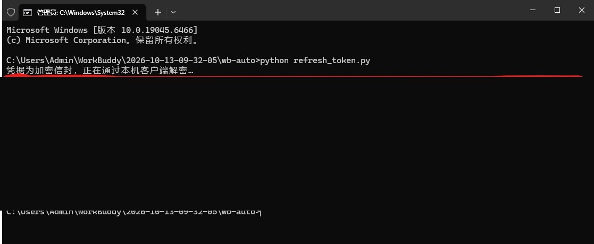
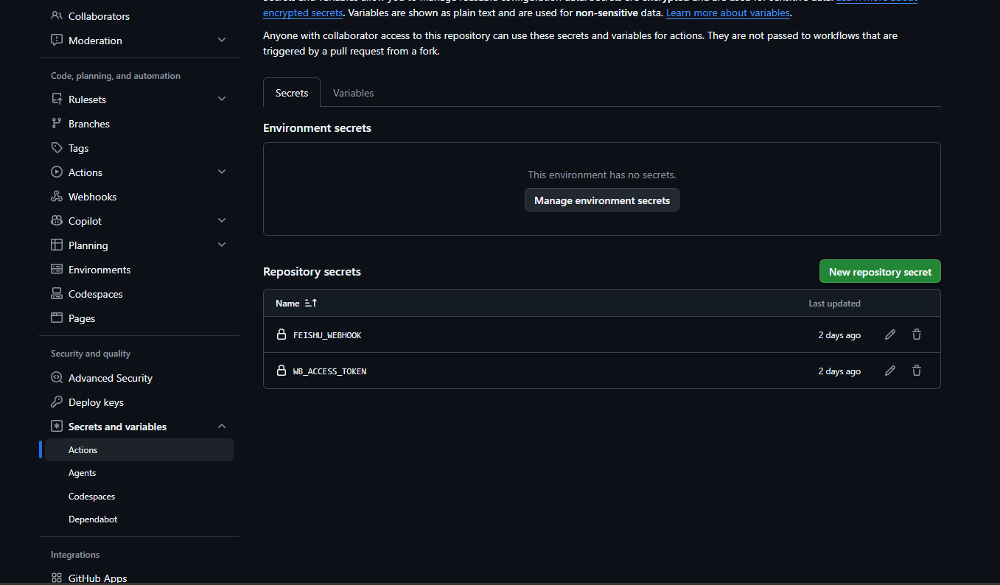

# WorkBuddy 多账号自动签到（GitHub Actions）

每天定时给多个 WorkBuddy 账号签到领积分、派猫猫旅行，结果汇总成一张飞书卡片。

脚本幂等：已签不重领、已派不重派；单个账号失败不影响其它账号。

## 文件


| 文件                            | 作用                                       |
| ----------------------------- | ---------------------------------------- |
| `wb_auto.py`                  | 云端执行主体：遍历全部账号，签到 / 领奖 / 派出 / 推飞书         |
| `refresh_token.exe`           | 本机一次性导出 token（免 Python，双击即用）             |
| `.github/workflows/daily.yml` | 定时任务（08:10 / 14:10 / 20:10 北京时间，三时段互为备份） |

## 用法

### 1. 新建仓库并上传

新建 Private 仓库，把本文件夹全部文件上传，`.github`**&#x20;文件夹必须带上**（网页拖拽容易漏掉点开头的文件夹，建议 `git push`）。

上传后进 **Actions** 页签，点 **I understand my workflows, go ahead and enable them** 启用。

### 2. 逐个账号导出 token

本机装好 WorkBuddy 并登录账号 A，双击 `refresh_token.exe`（首次被 SmartScreen 拦截：**更多信息 → 仍要运行**），

复制 `----- 以下为 token -----` 到 `----- 以上为 token -----` 之间的整段字符；

退出登录换账号 B，再运行一次导出。每个账号重复一次，token 分别保存好。




### 3. 配置两个 Secret

仓库 → **Settings → Secrets and variables → Actions → New repository secret**：


| Name             | 内容                                   |
| ---------------- | ------------------------------------ |
| `WB_ACCOUNTS`    | JSON：`{"主号":"tokenA","小号":"tokenB"}` |
| `FEISHU_WEBHOOK` | 飞书群自定义机器人地址（建机器人时**不要勾签名校验**）        |




### 4. 手动跑一次验证

Actions 页签左侧选本 workflow → **Run workflow**，等十几秒，飞书收到卡片即成功。

## WB\_ACCOUNTS 填写要点


```
{"主号":"eyJ...=","小号A":"eyJ...=","小号B":"eyJ...="}
```


* 引号、逗号、冒号都必须是**英文半角**；token 整段复制，别漏结尾的 `=`，中间不能有空格或换行。

* 名字只用于卡片展示，顺序按 JSON 里写的顺序渲染。

* **只填已经导出 token 的账号**：留空、占位符或没粘完整的条目会被自动跳过并在日志里告警，不打断其它账号；一个有效账号都没有时才报配置错误。

* 也支持对象形式 `{"主号":{"token":"...="}}` 和数组形式 `[{"name":"主号","token":"...="}]`，见 `wb_auto.py` 的 `load_accounts()` 注释。

* 只签一个账号时，可不建 `WB_ACCOUNTS`，改建单账号 Secret `WB_ACCESS_TOKEN` 也能跑。

## 注意事项


* **token 约 28 天过期**：日志或飞书出现「认证被拒 / 401 / 403」，就重跑 `refresh_token.exe`，把对应账号的 token 更新进 `WB_ACCOUNTS`。

* **账号建议 10\~20 以内**：单 job 超时 20 分钟、单个 Secret 48 KB、飞书单条消息体 20 KB，再多就要拆仓库或拆卡片。

* 三个 cron 是**冗余备份**，每次运行都跑全部账号，不要把账号拆到不同时段，否则某次 cron 被 GitHub 丢弃时那组账号当天会漏签。

* 平台规则通常要求一人一号，多账号使用可能触发风控，风险自行承担。